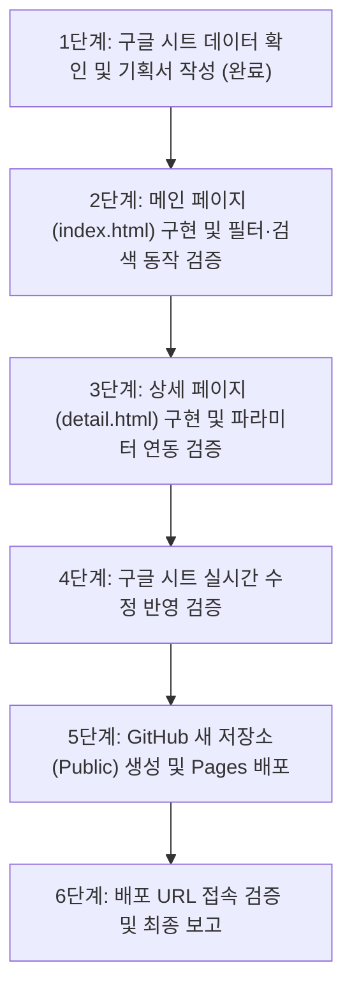

# 2026 부산대학교 직무연수 안내 웹사이트 작업 기획서

## 1. 프로젝트 개요
- **프로젝트명**: 2026학년도 부산대학교 교직원 직무연수 안내 웹사이트
- **목표**: 교직원이 2026년도 직무연수 과정을 한눈에 탐색하고, 구글 시트 데이터와 실시간 연동되어 업데이트가 즉시 반영되는 2페이지(메인·상세) 반응형 웹사이트 구축 및 GitHub Pages 배포
- **배포 방식**: GitHub Pages (정적 웹 호스팅)
- **작업 일자**: 2026-10-23

---

## 2. 데이터 소스 및 연동 아키텍처

### 2.1 구글 시트 데이터 소스
- **스프레드시트 ID**: `1yR6YWV91O3v-h5RMRTGm5MNYJ7SfPXcVWLBRT3jywRE`
- **시트 이름**: `data`
- **연동 URL (GViz CSV)**:
  ```
  https://docs.google.com/spreadsheets/d/1yR6YWV91O3v-h5RMRTGm5MNYJ7SfPXcVWLBRT3jywRE/gviz/tq?tqx=out:csv&sheet=data&headers=1
  ```
  > **기술적 분석 & 핵심 주의사항**:
  > - 구글 GViz 기본 호출 시 첫 13행을 단일 복합 헤더로 오인하는 gviz 휴리스틱 이슈가 있으므로, 반드시 `&headers=1` 파라미터를 추가하여 1행만 헤더로 인식되도록 합니다.
  > - 브라우저 캐싱 방지를 위해 실시간 요청 시 타임스탬프 쿼리(`&_t=${Date.now()}`)를 덧붙여 호출합니다.

### 2.2 CSV 파싱 및 실시간성
- **파서**: PapaParse 5.4.1 (CDN 활용)
- **방식**: 페이지 접속(새로고침) 시 비동기 `fetch` 및 PapaParse를 통해 메모리에 적재. 데이터 하드코딩 금지.
- **예외 처리**: 네트워크 지연/오류 시 재시도 안내 및 스켈레톤/로딩 UI 제공.

### 2.3 시트 컬럼 스키마 (17개 컬럼)
| 번호 | 컬럼명 | 설명 / 샘플 값 | 활용 페이지 및 용도 |
|---|---|---|---|
| 0 | `과정코드` | PNU-2026-001 ~ PNU-2026-901 (32개 과정) | 고유 키 (상세페이지 `?code=` 파라미터 매칭) |
| 1 | `과정명` | 직장 내 성희롱·성폭력 예방 교육 | 메인 카드 제목, 상세 제목, 검색 대상 |
| 2 | `분야` | 법정의무교육, 인사·노무, 정보화·AI·데이터 등 (10개) | 메인 1차 탭/카테고리 필터, 카드 배지 |
| 3 | `대상` | 전 직원, 실무자, 관리자, 신규자 (4개) | 필터 옵션, 상세 스펙 |
| 4 | `이수구분` | 필수, 필수(해당자), 권장, 선택 (4개) | 카드 배지(필수 강조), 필터 칩 |
| 5 | `교육방식` | 온라인, 집합, 혼합 (3개) | 카드 메타 배지, 필터 칩 |
| 6 | `교육시간` | 1시간, 4시간, 8시간 등 | 카드 메타 정보, 상세 스펙 |
| 7 | `정원` | 무제한, 30명 등 | 카드 메타 정보, 상세 스펙 |
| 8 | `교육기간` | 상시(2026-01-02~12-31), 2026-03-16~03-17 | 카드 일정 표시, 상세 스펙 |
| 9 | `신청기간` | 상시, 2026-03-02~03-11 | 접수 상태(접수중/예정/상시) 배지 및 상세 정보 |
| 10 | `담당부서` | 인재개발원, 정보화본부, 재무과, 총무과 등 (11개) | 메인 검색 대상, 상세 문의처 |
| 11 | `한줄소개` | 요약 설명 문구 | 메인 카드 본문 요약 |
| 12 | `상세소개` | 법령 근거 및 전체 과정 개요 | 상세 페이지 본문 |
| 13 | `학습목표` | ' · ' 구분 기호로 분리된 목표 목록 | 상세 페이지 체크리스트 UI |
| 14 | `주요내용` | ' · ' 구분 기호로 분리된 세부 내용 | 상세 페이지 모듈/커리큘럼 UI |
| 15 | `신청링크` | `https://hrd.pusan.ac.kr/course/...` | [수강신청 바로가기] CTA 버튼 링크 |
| 16 | `문의` | 부서명 및 전화번호 | 상세 페이지 문의 카드 |

---

## 3. UI/UX 디자인 시스템 (Frontend-Design 원칙 준수)

### 3.1 브랜드 아이덴티티 및 디자인 테마
- **Primary Color**: PNU Blue (`#003876`, `#005BAC` - 부산대학교 공식 아이덴티티 블루)
- **Secondary / Accent**: Warm Amber (`#D97706` - 필수 과정 강조용 배지), Emerald Green (`#059669` - 접수중 상태)
- **Background & Surface**: 
  - 메인 배경: `#F8FAFC` (Slate 50)
  - 카드 표면: `#FFFFFF` (White with Soft Border & Shadow)
- **Typography**: Pretendard (가독성 높은 모던 국문 고딕 웹폰트)
- **Icons**: Lucide Icons (또는 FontAwesome CDN)

### 3.2 디자인 옵션 비교 및 선정안 (Phase 1 Mockup 검토)
1. **옵션 A (포털/대시보드형 - 권장안)**:
   - 상단 히어로에 핵심 통계(전체 과정 수, 필수 과정 수, 온라인 과정 수)를 보여주고, 좌측/상단에 빠른 필터 탭과 검색바를 배치. 카드는 3열 반응형 그리드로 직관적인 카드 뷰 제공.
2. **옵션 B (테이블 리스트 중심의 행정문서형)**:
   - 행정 포털 스타일의 테이블 그리드 중심 구조. 정보 밀도는 높으나 모바일 가독성과 시각적 주목도가 떨어짐.
3. **옵션 C (캘린더/타임라인 중심형)**:
   - 일정별 타임라인 표시. 상시 과정이 10개 이상인 본 데이터 특성상 캘린더 빈 공간이 많아 부적합.
- **선정**: **옵션 A (모던 포털/카드 대시보드형)** 채택.

---

## 4. 폴더 구조 및 파일 명세

```
C:\Antigravity\Site development\2026-10-23\
├── PLAN.md                  # 작업 기획서 (본 문서)
├── index.html               # 메인 페이지 (전체 연수 개요, 검색, 다중 필터, 카드 그리드)
├── detail.html              # 상세 페이지 (개별 과정 상세, 커리큘럼, 신청 CTA, 문의)
├── css/
│   └── style.css            # 공통 커스텀 스타일 (Pretendard 폰트, 애니메이션, 스켈레톤 등)
└── js/
    ├── api.js               # 구글 시트 GViz 실시간 CSV 패치 & PapaParse 공통 모듈
    ├── main.js              # 메인 페이지 검색/필터/렌더링 로직
    └── detail.js            # 상세 페이지 파라미터 파싱 및 뷰 렌더링 로직
```

---

## 5. 페이지별 기능 단위 분해 및 상세 구성

### 5.1 메인 페이지 (`index.html`)

| 영역 | 구성 요소 | 기능 설명 |
|---|---|---|
| **GNB / 헤더** | 로고 & 내비게이션 | 부산대학교 로고 심볼 + '2026 교직원 직무연수 포털' 타이틀, 직무연수 안내 지침 링크 |
| **히어로 섹션** | 타이틀 & 통계 카드 | • 메인 카피: *"부산대학교의 미래를 여는 2026 교직원 직무연수"*<br>• 핵심 지표 4종: 전체 과정(32개), 필수 과정(7개), 온라인 상시(10개), 최신 업데이트 상태 |
| **검색 & 필터 바** | 통합 검색창 | 과정명, 한줄소개, 담당부서 실시간 텍스트 검색 (입력 즉시 디바운스 필터링) |
| | 분야별 카테고리 탭 | 전체 / 법정의무교육 / 직무공통·문서 / 예산·회계·계약 / 인사·노무 / 정보화·AI·데이터 / 대학행정 특화 등 10개 칩 |
| | 세부 필터 (드롭다운/토글) | • 이수구분: 전체, 필수, 권장, 선택<br>• 교육방식: 전체, 온라인, 집합, 혼합<br>• 대상: 전체, 전 직원, 실무자, 관리자, 신규자 |
| | 필터 리셋 & 정렬 | 선택된 필터 태그 표시, '초기화' 버튼, 정렬(과정코드순, 교육시간순) |
| **목록 영역** | 상태 표시기 | 검색 결과 개수("총 N개의 연수 과정이 검색되었습니다") |
| | 카드 그리드 (3열 반응형) | • 이수구분 태그 (필수 배지는 주황/빨강 강조)<br>• 교육방식 & 시간 배지 (온라인/집합/혼합, N시간)<br>• 과정명 (굵은 타이포)<br>• 한줄소개 요약문<br>• 교육기간 및 신청기간<br>• 담당부서<br>• [상세보기 →] 클릭 시 `detail.html?code=PNU-2026-xxx`로 이동 |
| | 빈 화면 (Empty State) | 검색 조건에 맞는 과정이 없을 때 초기화 안내 UI |
| | 로딩 스켈레톤 | 데이터 로드 중 스켈레톤 카드 애니메이션 노출 |
| **푸터** | 연락처 & 기관 정보 | 부산대학교 인재개발원 / 문의처 안내 및 저작권 표기 |

### 5.2 상세 페이지 (`detail.html`)

| 영역 | 구성 요소 | 기능 설명 |
|---|---|---|
| **상단 네비게이션** | 뒤로가기 & 브레드크럼 | • `← 목록으로 돌아가기` (메인 이동 버튼)<br>• 홈 > 직무연수 안내 > [분야명] > [과정명] |
| **과정 헤더** | 과정 핵심 타이틀 | • 과정코드 (예: `PNU-2026-001`)<br>• 분야 배지 & 이수구분 배지 (필수/선택/권장)<br>• 대형 과정명 타이틀<br>• 한줄소개 서브타이틀 |
| **핵심 요약 바** | 메타 정보 하이라이트 | 교육방식, 총 교육시간, 교육정원, 교육기간, 신청기간, 담당부서를 아이콘과 함께 그리드로 요약 |
| **본문 영역 (좌측 70%)** | 과정 상세 소개 | 법정 근거 및 교육 취지, 상세 안내 문단 |
| | 학습 목표 | ' · ' 구분 데이터를 파싱하여 체크 아이콘이 붙은 불릿 목록 렌더링 |
| | 주요 교육 내용 | ' · ' 구분 데이터를 단계별 커리큘럼/모듈 카드로 구조화하여 표시 |
| **사이드 패널 (우측 30%)** | 수강신청 액션 카드 | • 현재 신청 기간 안내<br>• **[수강신청 바로가기 (외부링크)]** 대형 CTA 버튼 (새 탭 열기)<br>• 링크 복사 (공유) 버튼 |
| | 문의처 안내 카드 | 담당부서 및 전화번호 표시, 원클릭 전화걸기(`tel:`) 지원 |
| **하단 네비게이션** | 이전 / 다음 과정 이동 | 동일 카테고리 또는 전체 과정 기준 이전/다음 과정 이동 링크 |
| **예외 처리** | 유효하지 않은 코드 접근 | URL의 code가 없거나 잘못되었을 때 "과정을 찾을 수 없습니다" 경고 및 메인 복귀 버튼 |

---

## 6. 단계별 작업 절차 및 검증 시나리오



1. **[진행 중] 1단계: 구글 시트 데이터 확인 및 작업 기획서(md) 작성**
   - 구글 시트 GViz 엔드포인트 동작 확인 (완료)
   - 17개 컬럼 및 32개 연수 과정 데이터 구조 분석 (완료)
   - 기획서 파일(`PLAN.md`) 생성 및 사용자 승인 대기
2. **2단계: 메인 페이지(`index.html`) 구현 및 테스트**
   - HTML/CSS/JS 구조화 및 CDN(Tailwind, PapaParse, Lucide) 연동
   - 구글 시트 실시간 데이터 로드 및 카드 렌더링
   - 다중 필터(분야, 이수구분, 방식, 대상) 및 실시간 검색 동작 검증
3. **3단계: 상세 페이지(`detail.html`) 구현 및 테스트**
   - URL 파라미터(`?code=`) 연동 및 상세 데이터 바인딩
   - 커리큘럼/학습목표 모듈화 및 수강신청 CTA 버튼 동작 검증
4. **4단계: 구글 시트 실시간 수정 반영 검증**
   - 구글 시트의 데이터 한 칸을 확인하고 새로고침 시 실시간 반영 여부 검증
5. **5단계: 깃허브 저장소 생성 및 GitHub Pages 배포**
   - GitHub CLI(`gh`)를 통해 public 저장소 생성 및 파일 커밋/푸시
   - GitHub Pages 브랜치 배포 활성화
6. **6단계: 배포 URL 검증 및 최종 정리**
   - 실제 배포된 웹사이트 URL 및 저장소 주소 확인 후 완료 보고
